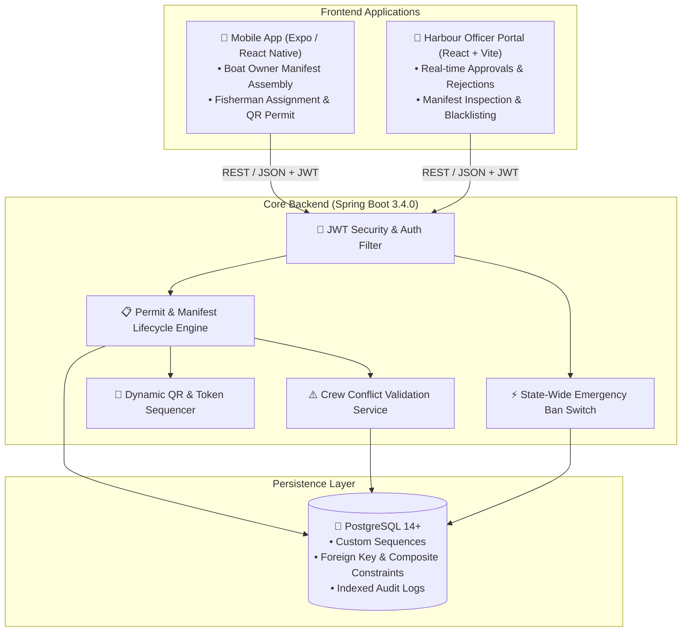

# Fisher-Token: Automated Digital Fishing Permit, Crew Verification & Maritime Security System

[](https://spring.io/projects/spring-boot)
[](https://www.oracle.com/java/)
[](https://react.dev/)
[](https://expo.dev/)
[](https://vitejs.dev/)
[](https://www.postgresql.org/)
[](https://www.typescriptlang.org/)
[](LICENSE)

An enterprise-grade, multi-tier digital governance and maritime security platform engineered for coastal fisheries departments (tailored for the **Department of Fisheries and Fishermen Welfare, Government of Tamil Nadu**).

---

## 🌊 Overview & Problem Statement

In coastal maritime jurisdictions, thousands of artisanal and mechanized fishing boats venture into deep sea waters daily. Conventional harbour management relies on manual paper tokens, physical register sign-ins, and spot inspections. This legacy approach suffers from severe vulnerabilities:

1. **No Real-Time Maritime Visibility**: Inability for port authorities and Coast Guard to track active vessels currently offshore.
2. **"Ghost Crew" & Unregistered Persons**: Lack of biometric/digital identity binding at departure gates.
3. **Duplicate Crew Assignment**: The same fisherman being illicitly listed on multiple vessels simultaneously for quota manipulation or welfare claims.
4. **Search and Rescue (SAR) Bottlenecks**: In cyclones or mid-sea emergencies, rescue teams lack an instantaneous, verified crew manifest.

**Fisher-Token** provides an end-to-end digital solution that automates 24-hour fishing permits, enforces real-time crew conflict validation, generates tamper-evident QR digital tokens, and gives port officers and state administrators live situational awareness.

---

## 🏛️ System Architecture



---

## 🚀 The Operational Tiers

### 1. 🚤 Boat Owner Mobile App (React Native / Expo)
* **Secure Authentication**: Mobile OTP login bound to Boat Registration Number (e.g., `TN-09-MM-1234`).
* **Crew Manifest Assembly**: Search and attach registered fishermen by unique ID (`FISH-00101`).
* **Automated Pre-Validation**: Prevents duplicate selection and exceeding vessel capacity.
* **Live Digital Permit**: 24-hour countdown timer, permit number, and tamper-evident QR code.
* **Offline Portability**: Generates downloadable/printable PDF permits via `expo-print`.

### 2. ⚓ Fisherman / Crew Mobile App
* **OTP Sign-In**: Login using registered Fisherman ID.
* **Voyage Assignment**: View which boat owner and vessel have assigned them for the voyage.
* **Live Permit View**: Access live 24-hour permit countdown and crew manifest.
* **Voyage History**: Comprehensive historical log of all past voyages and boat owners.

### 3. 🏢 Harbour Port Officer Web Portal (React + Vite + Tailwind CSS)
* **Port-Scoped Dashboard**: Live statistics for Chennai, Kasimedu, Tuticorin, Rameswaram, etc.
* **Permit Workflow**: Inspect boat owner details, verify crew eligibility, approve or reject with audit reasons.
* **Registry & Sanctions**: Search fishermen/owners and blacklist individuals ineligible for sea voyages.

---

## 🛠️ Tech Stack

| Component | Technologies |
| :--- | :--- |
| **Backend Engine** | Spring Boot 3.4.0, Java 17, Spring Data JPA, Hibernate, Jakarta Validation, Lombok |
| **Security & Auth** | Spring Security, JJWT (HMAC-SHA256), BCrypt Password Encoder, CORS Filter |
| **Database** | PostgreSQL 14+ (Relational schema, B-Tree indexes, custom sequence token generation) |
| **Mobile App** | React Native, Expo SDK 57, Expo Router, Axios, `expo-print`, `react-native-qrcode-svg` |
| **Officer Web App** | React 18, Vite 6, TypeScript, Tailwind CSS, Lucide Icons |

---

## 📁 Repository Structure

```text
fisher-token/
├── backend/                             # Spring Boot REST API
│   ├── src/main/java/com/backend/FishingPermit/
│   │   ├── config/                      # Security & JWT configurations
│   │   ├── controller/                  # REST Controllers (Permit, Auth, Officer, Admin)
│   │   ├── dto/                         # Request/Response DTO models
│   │   ├── entity/                      # JPA Database Entities
│   │   ├── repository/                  # Spring Data JPA Repositories
│   │   └── service/                     # Business logic & conflict detection
│   ├── src/main/resources/
│   │   ├── application.properties       # Environment-parameterized configuration
│   │   ├── application.properties.example # Sample properties template
│   │   └── schema.sql                   # PostgreSQL schema definitions
│   └── pom.xml                          # Maven build dependencies
│
├── frontend/
│   ├── mobile-app/                      # React Native / Expo Mobile Client
│   │   ├── src/app/                     # Expo Router navigation screens
│   │   ├── src/pages/                   # Boat Owner & Fisherman UI views
│   │   ├── src/services/api.ts          # Dynamic host discovery & Axios client
│   │   ├── app.json                     # Expo configuration
│   │   └── package.json
│   │
│   ├── web-app-office/                  # Harbour Officer Portal
│   │   ├── src/pages/                   # Dashboard, Approvals, Registry, Blacklist
│   │   ├── src/services/api.ts          # API integration
│   │   ├── .env.example                 # Environment configuration template
│   │   └── package.json
│
├── .gitignore                           # Production-ready git ignore rules
├── LICENSE                              # MIT License
└── README.md                            # Project documentation
```

---

## ⚡ Quickstart & Setup Guide

### 1. Prerequisites
Ensure you have the following installed on your development machine:
* **Java Development Kit (JDK) 17+**
* **Node.js 18+ & npm**
* **PostgreSQL 14+**
* **Expo Go App** (on iOS or Android device for mobile testing)

---

### 2. Database Setup (PostgreSQL)

1. Launch PostgreSQL and create the database:
   ```sql
   CREATE DATABASE fishing_permit_db;
   ```
2. Run the initialization script located at `backend/src/main/resources/schema.sql` or let Spring Boot automatically validate and update the schema upon first run.

---

### 3. Backend Setup (Spring Boot)

1. Navigate to the `backend/` directory:
   ```bash
   cd backend
   ```
2. Configure your database connection in `src/main/resources/application.properties` or set environment variables:
   ```bash
   export DB_URL=jdbc:postgresql://localhost:5432/fishing_permit_db
   export DB_USERNAME=postgres
   export DB_PASSWORD=your_password
   ```
3. Run the Spring Boot application:
   * **Windows**:
     ```powershell
     .\mvnw.cmd spring-boot:run
     ```
   * **Linux / macOS**:
     ```bash
     ./mvnw spring-boot:run
     ```
   The backend server will start on `http://localhost:8082`.

---

### 4. Harbour Officer Web Portal Setup

1. Open a new terminal and navigate to:
   ```bash
   cd frontend/web-app-office
   ```
2. Install dependencies:
   ```bash
   npm install
   ```
3. Create your `.env` file from the example:
   ```bash
   cp .env.example .env
   ```
4. Start the Vite development server:
   ```bash
   npm run dev
   ```
   Open `http://localhost:5173` in your browser.

---

### 5. Mobile Application Setup (Boat Owners & Fishermen)

1. Navigate to the mobile app folder:
   ```bash
   cd frontend/mobile-app
   ```
2. Install dependencies:
   ```bash
   npm install
   ```
3. Start the Expo bundler:
   ```bash
   npx expo start
   ```
4. **Testing on a Physical Device**:
   * Scan the terminal QR code using **Expo Go** (Android) or the **Camera app** (iOS).
   * Ensure your phone is connected to the same Wi-Fi network as your backend computer. The app automatically detects your host machine's IP address.

---

## 🔑 Default Credentials & Test Data

| Portal | Username / ID | Password | Role |
| :--- | :--- | :--- | :--- |
| **Harbour Officer Portal** | `admin` | `Admin@123` | Port Officer |
| **Boat Owner Mobile** | Registered Boat Reg No (e.g. `TN-09-MM-1234`) | OTP Verification (`123456`) | Vessel Owner |
| **Fisherman Mobile** | Registered Fisherman ID (e.g. `FISH-00101`) | OTP Verification (`123456`) | Crew Member |

---

## 🛡️ Key Security & Anti-Fraud Features

* **Real-Time Crew Conflict Detection**: When a boat owner submits a manifest, the backend checks whether any crew member is already assigned to another active voyage for the same calendar date. Conflicting requests are instantly blocked.
* **Tamper-Evident QR Code Verification**: Approved permits generate a cryptographically verifiable QR payload. Scanning the QR code at port checkpoints validates vessel legitimacy and active timestamps in real time.
* **24-Hour Automated Expiration**: Permits automatically count down from the time of departure approval and expire after 24 hours, preventing reused manifests.
* **IMD Weather Alert Killswitch**: In severe weather or cyclone warnings, State Admins can trigger the emergency toggle to freeze permit issuance across all coastal harbours with a single click.

---

## 🤝 Contributing

Contributions, issues, and feature requests are welcome!
1. Fork the Project.
2. Create your Feature Branch (`git checkout -b feature/MaritimeFeature`).
3. Commit your Changes (`git commit -m 'Add MaritimeFeature'`).
4. Push to the Branch (`git push origin feature/MaritimeFeature`).
5. Open a Pull Request.

---

## 📄 License

This project is licensed under the MIT License - see the [LICENSE](LICENSE) file for details.
